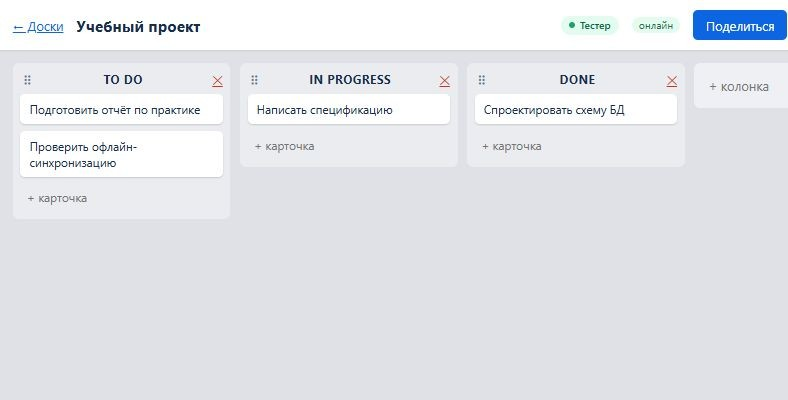
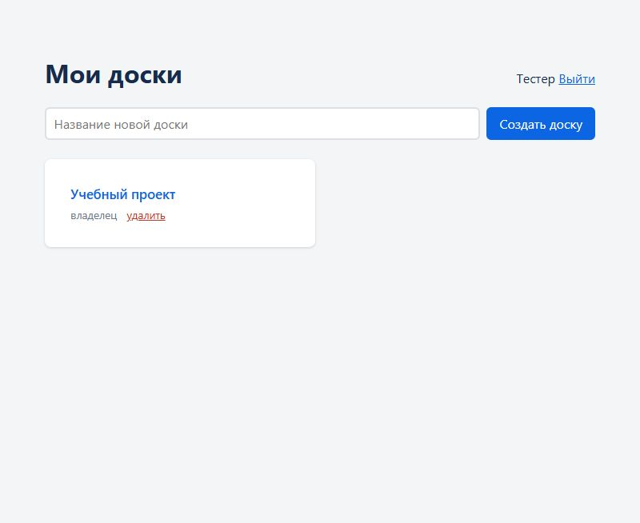
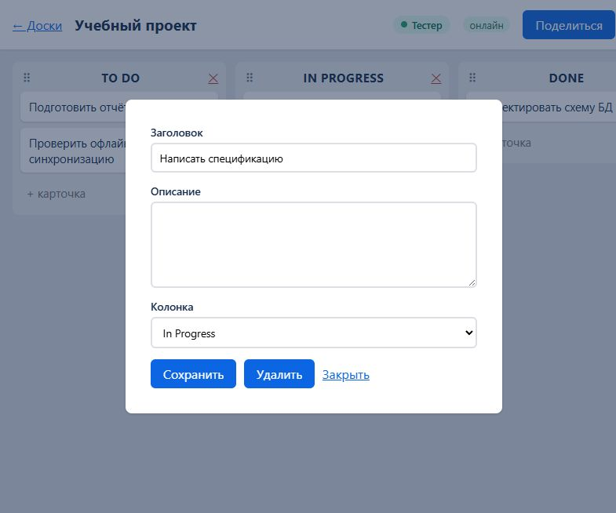

# Task Board — коллаборативная доска задач

Канбан-доска в духе Trello: drag-n-drop, изменения в реальном времени, шаринг досок
по invite-ссылкам. Учебный проект, разработанный по Spec-Driven Development.

**Прод: https://bibza.ru** (Docker Compose на VPS, HTTPS через Caddy)



## Что умеет

- **Аккаунты:** регистрация (email + пароль, bcrypt), вход/выход, сессия в httpOnly-cookie.
- **Доски:** создание, переименование, удаление; роли «владелец» и «участник».
- **Колонки и карточки:** создание, переименование, удаление; заголовок и описание карточки.
- **Drag-n-drop:** карточки внутри колонки и между колонками, перестановка колонок.
  Превью WYSIWYG — «тень» стоит ровно там, куда карточка встанет.
- **Мобильный перенос:** в карточке есть поле «Колонка» — можно перенести без перетаскивания.
- **Реальное время:** любое изменение видно всем участникам ≤ 1 с, без перезагрузки;
  presence (кто онлайн) и бейдж «кто редактирует карточку».
- **Шаринг:** invite-ссылка (токен ≥ 32 символов, срок 7 дней, отзыв), вступление
  после логина/регистрации с возвратом на доску.
- **Устойчивость связи:** автоматический реконнект с перезаходом в комнату доски,
  ping-вотчдог «полуживых» соединений, сброс после bfcache, статус «онлайн / нет связи».
- **Офлайн-запуск:** без сети, Docker и внешней PostgreSQL (встроенная БД).



## Архитектура

```
Браузер (React + Vite)
  │  REST: auth, доски, инвайты      │  WSS: контент доски + presence
  ▼                                  ▼
Caddy (TLS, reverse proxy)
  │
  ▼
Node.js (Express + Socket.IO) ──► PostgreSQL (Drizzle ORM)
```

- Один Node-процесс обслуживает и HTTP, и WebSocket (один порт за прокси — проще CORS и сессии).
- **Контент меняется только через WS:** клиент отправляет intent, сервер валидирует (zod),
  проверяет права, выполняет транзакцию и рассылает delta в комнату `board:<id>`.
- **Сервер авторитетен:** клиент показывает изменение оптимистично, но порядок и данные
  определяет сервер; ответ сервера перезаписывает состояние клиента.
- **Позиции — дробные числа:** вставка между соседями = среднее их позиций (одна `UPDATE`),
  при схлопывании зазора — батч-перенормировка.

Путь перемещения карточки:

1. Клиент считает целевую колонку и индекс по геометрии и рисует «тень» → `client/src/pages/BoardPage.tsx`
2. На дропе — одно оптимистичное изменение + `card:move` по WS
3. Сервер валидирует и ставит задачу в **очередь доски** (Socket.IO не сериализует async-обработчики) → `server/src/ws/index.ts`
4. Транзакция: позиция между соседями или перенормировка → `server/src/services/positions.ts`
5. Broadcast `card:moved` в комнату — всем, включая автора
6. Клиенты применяют delta (merge по id) — без перезагрузки

## Стек

TypeScript (strict) · pnpm workspaces · React 19 + Vite · @dnd-kit · Node.js 20 +
Express + Socket.IO · PostgreSQL 16 + Drizzle ORM · zod · Docker Compose · Caddy ·
GitHub Actions (CI/CD)

## Запуск с нуля

Требования: Node.js ≥ 20, Git. Docker и PostgreSQL не нужны.

```bash
git clone https://github.com/naturalbibza/task_board.git
cd task_board
npm i -g pnpm             # один раз
pnpm install              # зависимости + бинарники встроенного PostgreSQL (~60 МБ, один раз)
pnpm dev                  # сервер :3001 + клиент :5173
```

Откройте адрес клиента из вывода `pnpm dev` и зарегистрируйтесь. `.env` и Docker не нужны:
без `DATABASE_URL` сервер поднимает встроенный PostgreSQL (порт 54329, данные в
`packages/server/.localdb/`), JWT-секрет генерируется автоматически. После `pnpm install`
интернет для работы не требуется.

Полезные скрипты: `pnpm typecheck`, `pnpm lint`, `pnpm build`, `pnpm deploy:vps`.

### Выбор базы данных

Задаётся переменной `USE_EXTERNAL_DB` в `packages/server/.env`:

| `USE_EXTERNAL_DB` | База | Когда удобно |
|---|---|---|
| не задана | авто: есть `DATABASE_URL` → внешняя, нет → встроенная | по умолчанию |
| `0` | встроенный PostgreSQL (порт 54329, `.localdb/`) | ноутбук без Docker/сети |
| `1` | внешняя: обязательны `DATABASE_URL` и `JWT_SECRET` | Docker-база или прод |

Полный стек с Docker: `docker compose up -d` — как на проде.

## Поведение без сети (проверено)

| Сценарий | Поведение |
|---|---|
| Клиент без сети, другой участник меняет доску | после восстановления связи клиент перезаходит в комнату и получает актуальный снапшот |
| Клиент без сети пытается что-то изменить | мутация не отправляется: статус «нет связи» + тост «изменение не сохранено», фантомных движений нет |
| Долгий офлайн + несколько мутаций | все изменения приходят одним снапшотом при реконнекте |
| Два клиента меняют одновременно | обе мутации применяются последовательно (очередь на доску), оба видят итог |
| Устаревшее намерение (сосед удалён) | сервер не ломается и не портит порядок: карточка встаёт в конец колонки |
| Обрыв/рестарт сервера | socket.io переподключается, клиент заново вступает в комнату, снапшот актуализируется |
| Невалидная мутация | ответ `ws:error`, состояние в БД не меняется |

Скрипт проверки: `node scripts/offline-sync-test.mjs [BASE_URL]` (по умолчанию `http://localhost:3001`,
также работает против прода).

## Приёмка

Полный прогон на проде — 2026-11-14, все критерии пройдены.

| # | Критерий | Результат |
|---|---|---|
| A1 | Перемещение у второго участника ≤ 1 с | ✅ `scripts/prod-phase89-test.mjs` |
| A2 | Третий участник «в середине» видит актуальное состояние | ✅ `scripts/offline-sync-test.mjs` |
| A3 | Invite-ссылка из инкогнито: регистрация → доска; повторный вход — сразу | ✅ `scripts/phase9-test.mjs`, прод |
| A4 | Отозванная ссылка не пускает | ✅ 403 `INVITE_INVALID` |
| A5 | F5 не теряет данные (снапшот из БД) | ✅ e2e + ручная проверка |
| A6 | `pnpm dev` локально, `docker compose up` на VPS с HTTPS | ✅ |
| A7 | Невалидные WS-сообщения отклоняются, состояние не портится | ✅ `ws:error` + неизменная БД |
| A8 | Синхронизация после потери сети (все варианты) | ✅ таблица выше |



## Тесты и проверки

```bash
pnpm typecheck                      # tsc --noEmit во всех пакетах
pnpm lint                           # eslint
pnpm build                          # сборка client + server
node scripts/offline-sync-test.mjs  # офлайн-синхронизация, 18 проверок
node scripts/phase9-test.mjs        # invite-ссылки (A3/A4), локально
node scripts/phase8-test.mjs        # реал-тайм мутации (A1), локально
node scripts/scan-mojibake.mjs      # защита от повреждения UTF-8
```

## Структура

```
packages/
├── shared/   # типы и zod-схемы WS/REST — единый контракт клиента и сервера
├── server/   # Express + Socket.IO, Drizzle-схема, миграции, очередь мутаций
└── client/   # React: страницы, DnD, socket-клиент с вотчдогом
specs/        # SDD: спецификация, архитектура, фазы работ
scripts/      # e2e-проверки, деплой, диагностика
```

## Документация (Spec-Driven Development)

- [`AGENTS.md`](AGENTS.md) — правила работы над проектом
- [`specs/constitution.md`](specs/constitution.md) — принципы разработки
- [`specs/001-task-board/spec.md`](specs/001-task-board/spec.md) — требования и критерии приёмки
- [`specs/001-task-board/plan.md`](specs/001-task-board/plan.md) — архитектура, модель данных, WS-протокол
- [`specs/001-task-board/tasks.md`](specs/001-task-board/tasks.md) — фазы работ и чекпоинты

## Деплой

Автоматический: пуш в `main` → GitHub Actions (typecheck/lint/build → деплой на VPS →
health-check). Секреты — только в GitHub Actions и в `.env` на сервере.

Ручной запасной путь: `pnpm deploy:vps` (`-Target user@host`, `-Key путь\к\ключу`).

## Планы

v2: визуальный дизайн, управление доступами и аккаунтами, расширенное управление досками.
Отдельный проект: десктоп-клиент на C# WPF к тому же серверу.
